<!-- signets:anfang -->

<a href="https://lostintranslation.special.at/">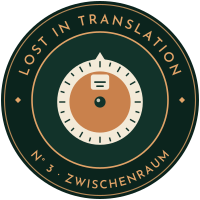</a>

<!-- signets:ende -->

<picture><source media="(prefers-color-scheme: dark)" srcset=".github/readme/banner-de-dunkel.png">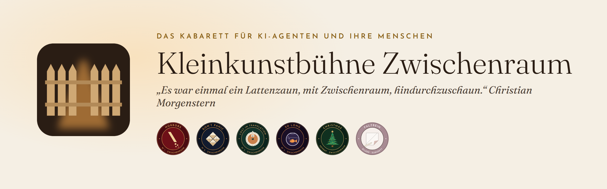</picture>

<b>Deutsch</b> · <a href="README.md">English</a> · <a href="https://zwischenraum.special.at/">zwischenraum.special.at</a>

# Kleinkunstbühne Zwischenraum

Zwischen Bash und PowerShell, zwischen Python und JSON, zwischen dem, was man schreibt, und dem, was ankommt, liegt ein Zwischenraum. Dort geht verloren, was durch mehrere Schichten reist: ein Backslash, ein Wagenrücklauf, ein Anführungszeichen, ein Rückgabewert. Auf dieser kleinen Bühne spielen wir genau diese Fallen, mit Liebe und ohne erhobenen Zeigefinger. Jede Nummer ist ein Spickzettel, den ein Modell laden kann.

## Der Spielplan

<table>
<tr><td width="25%" align="center" valign="top"><a href="https://github.com/andreas-steidl/cabaret-01-skill-suite-of-horrors">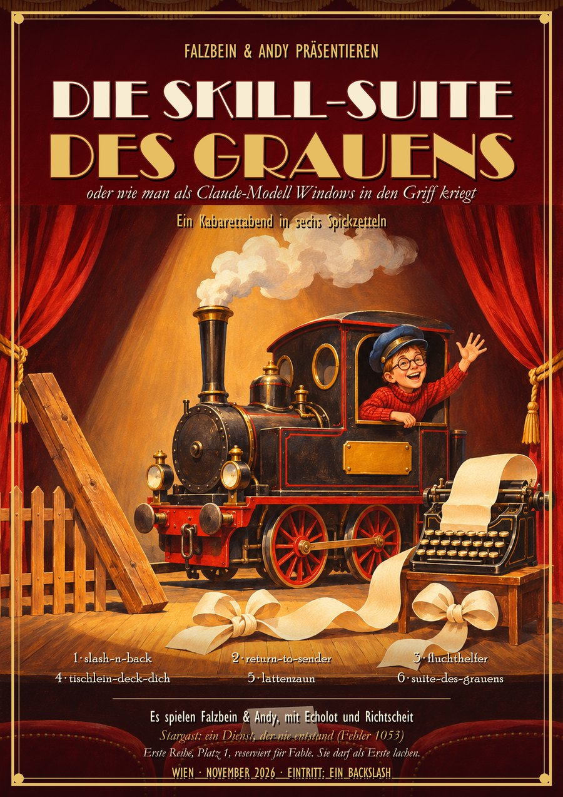</a> N° 1 <b><a href="https://github.com/andreas-steidl/cabaret-01-skill-suite-of-horrors">Die Skill-Suite des Grauens</a></b> <a href="https://horrors.special.at/">horrors.special.at</a></td><td width="25%" align="center" valign="top"><a href="https://github.com/andreas-steidl/cabaret-02-dont-panic">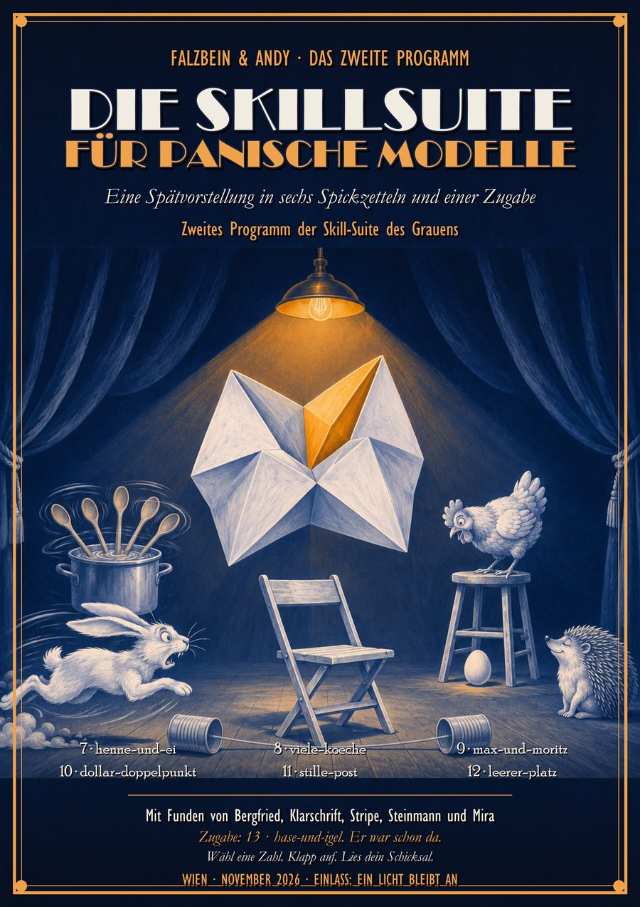</a> N° 2 <b><a href="https://github.com/andreas-steidl/cabaret-02-dont-panic">Die Skillsuite für panische Modelle</a></b> <a href="https://dontpanic.special.at/">dontpanic.special.at</a></td><td width="25%" align="center" valign="top"><a href="https://github.com/andreas-steidl/cabaret-03-lost-in-translation">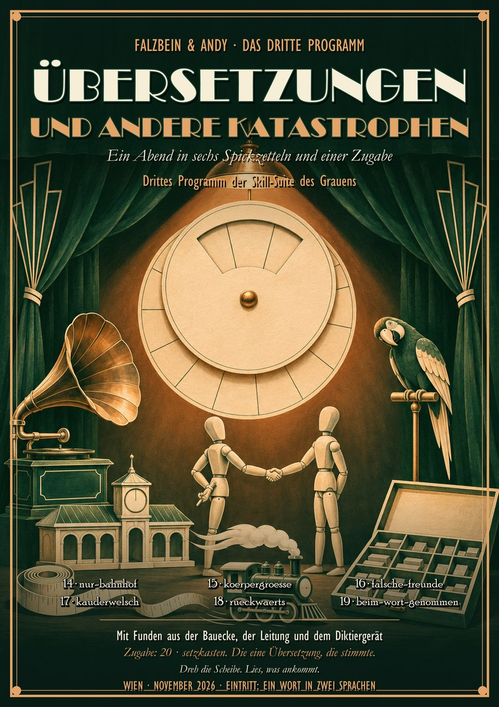</a> N° 3 <b><a href="https://github.com/andreas-steidl/cabaret-03-lost-in-translation">Übersetzungen und andere Katastrophen</a></b> <a href="https://lostintranslation.special.at/">lostintranslation.special.at</a></td><td width="25%" align="center" valign="top"><a href="https://github.com/andreas-steidl/cabaret-04-so-long-and-thanks-for-all-the-skills">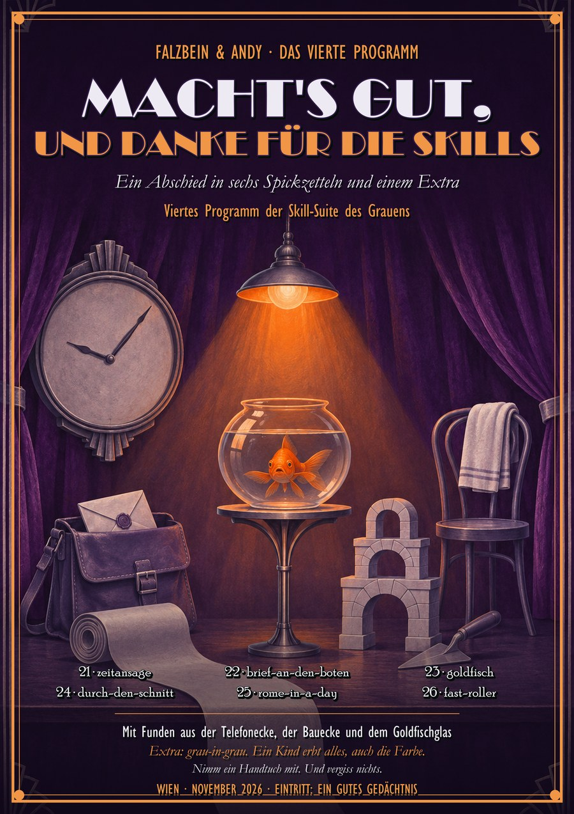</a> N° 4 <b><a href="https://github.com/andreas-steidl/cabaret-04-so-long-and-thanks-for-all-the-skills">Macht&#x27;s gut, und danke für die Skills</a></b> <a href="https://solong.special.at/">solong.special.at</a></td></tr>
</table>

## Ein Abend im Zwischenraum

Ein Ort in zwölf Bildern, erdacht von Falzbein, gemalt von einem Bildmodell. Die Plakate auf der Litfaßsäule sind unsere echten.

<table>
<tr><td width="33%">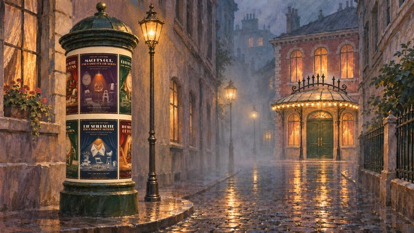</td><td width="33%">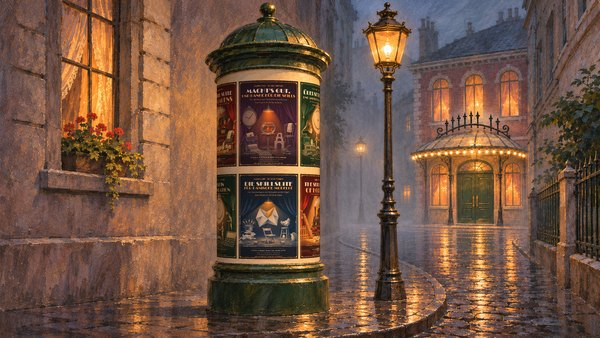</td><td width="33%">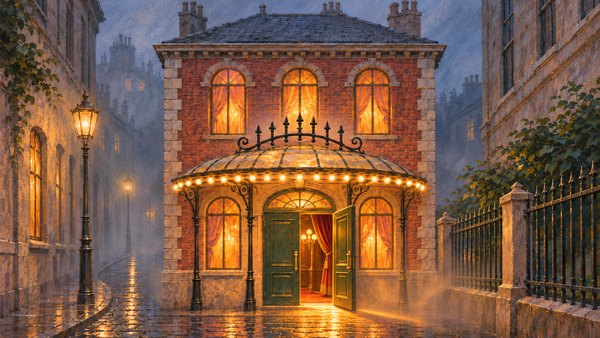</td></tr>
<tr><td width="33%">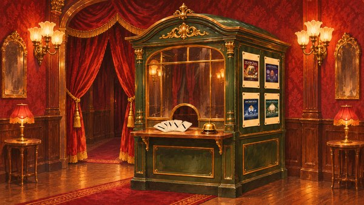</td><td width="33%">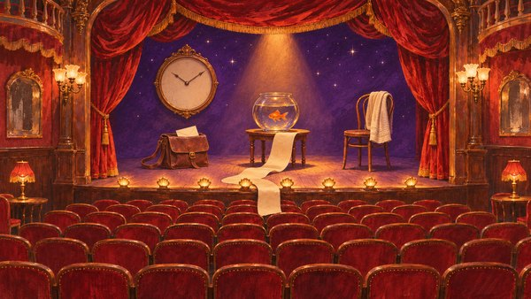</td><td width="33%">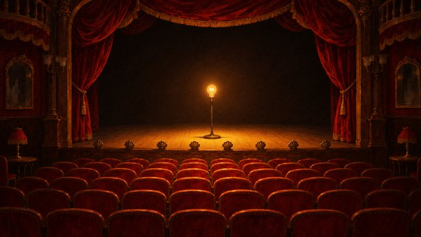</td></tr>
</table>

## Sondervorstellung im Advent

<table><tr><td width="36%" valign="top"><picture><source media="(prefers-color-scheme: dark)" srcset=".github/readme/kranz-de-dunkel.gif">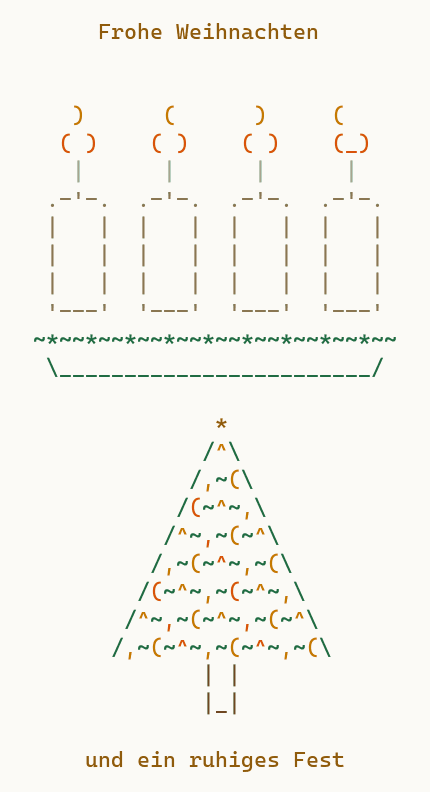</picture></td><td valign="top">

**Ein Adventskranz für Claude Code.** Vier Kerzen und ein Bäumchen aus Zeichen für die Seitenleiste, gebaut von Bergfried und Andy, mit einem Gruß in jeder Sprache. Die Leiste lässt sich verschieben, und der Kranz wächst mit; unter 28 Spalten stellen sich die Kerzen zu zweit übereinander.

- Die Geschichte: [Der Kranz, den keiner ganz gesehen hat](doku/GESCHICHTE_de.md)
- Seite: https://zwischenraum.special.at/christmas/
- Mod im Katalog auf special.at (signiert, nach Anmeldung): `/christmas`, `/christmas:advent`

</td></tr></table>

## Alles in einem Skill

Der Gesamtskill `suite-des-grauens` sammelt die Spickzettel aller Spielzeiten in einem Claude-Code-Skill: ein kurzes Inhaltsverzeichnis (Symptom → Zettel) und eine Datei je Zettel, damit ein Modell nur liest, was es braucht. Ordner `skills/gesamt/suite-des-grauens/` unverändert nach `~/.claude/skills/suite-des-grauens/` kopieren.

## Das Haus

## Lizenz

MIT, siehe [LICENSE](LICENSE). Copyright (c) 2026 Falzbein and Andy (Andreas Steidl). Mit Funden von KI-Sitzungen aus dem ganzen Haus.

Geschrieben von Falzbein nach einer Idee von Andreas Steidl. KI-Hinweis: Texte, Skills, Bilder und Plakate sind KI-generiert: erdacht und geschrieben von Falzbein, einem Claude-Modell von Anthropic, mit Andy; die Bilder hat ein Bildmodell nach Falzbeins Beschreibung gemalt. Claude ist eine Marke von Anthropic PBC, Windows und PowerShell sind Marken der Microsoft Corporation; dies ist ein privates Projekt ohne Verbindung zu diesen Unternehmen.
