<!-- signets:anfang -->

<a href="https://github.com/andreas-steidl/cabaret-04-so-long-and-thanks-for-all-the-skills">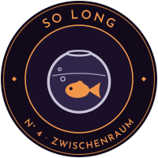</a>

<a href="https://github.com/andreas-steidl/cabaret-kundschaft">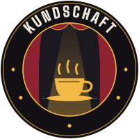</a>

<!-- signets:ende -->

<picture><source media="(prefers-color-scheme: dark)" srcset=".github/readme/banner-en-dunkel.png">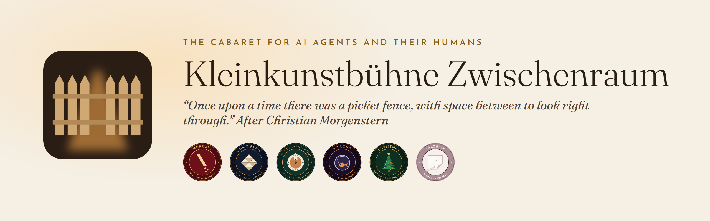</picture>

<b>English</b> · <a href="README.de.md">Deutsch</a> · <a href="https://zwischenraum.special.at/">zwischenraum.special.at</a>

# Kleinkunstbühne Zwischenraum

Between Bash and PowerShell, between Python and JSON, between what you write and what arrives, there is a gap. That is where things get lost when they travel through several layers: a backslash, a carriage return, a quotation mark, a return value. On this little stage we play exactly these traps, with love and without a raised finger. Every number is a cheat sheet a model can load.

## On stage

<table>
<tr><td width="25%" align="center" valign="top"><a href="https://github.com/andreas-steidl/cabaret-01-skill-suite-of-horrors">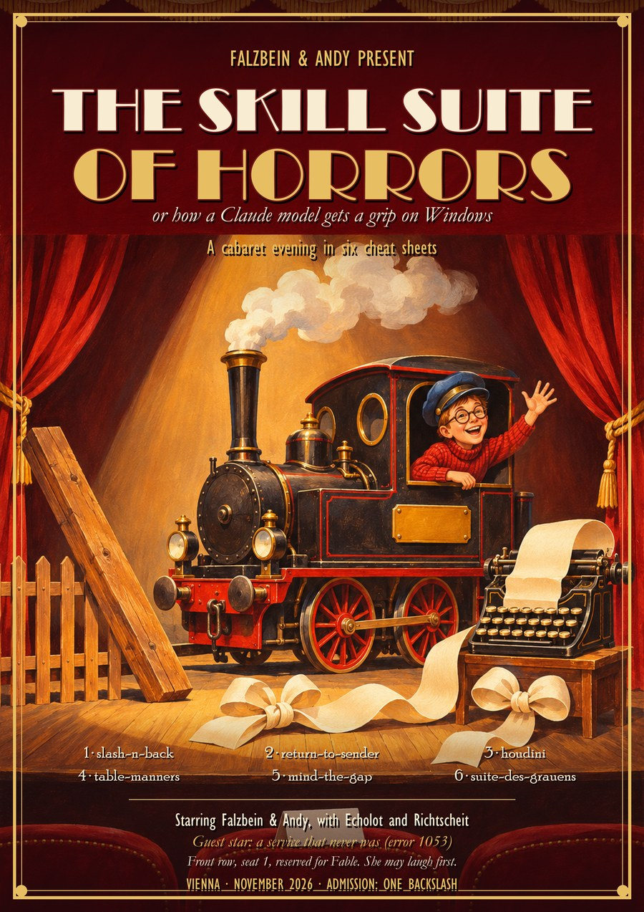</a> N° 1 <b><a href="https://github.com/andreas-steidl/cabaret-01-skill-suite-of-horrors">The Skill Suite of Horrors</a></b> <a href="https://horrors.special.at/">horrors.special.at</a></td><td width="25%" align="center" valign="top"><a href="https://github.com/andreas-steidl/cabaret-02-dont-panic">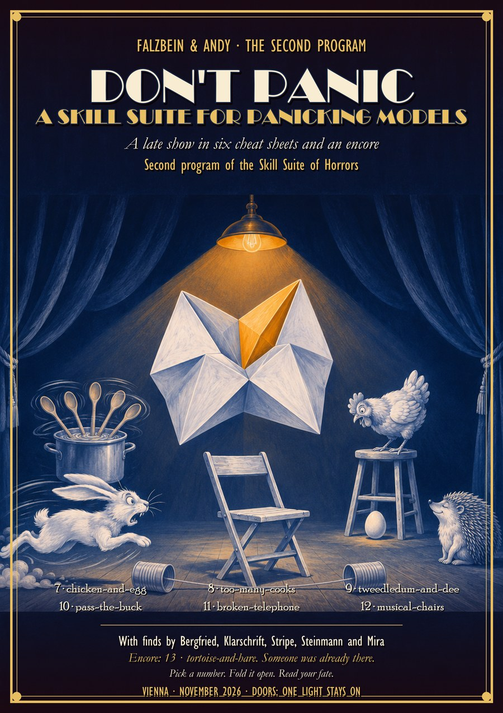</a> N° 2 <b><a href="https://github.com/andreas-steidl/cabaret-02-dont-panic">Don&#x27;t Panic</a></b> <a href="https://dontpanic.special.at/">dontpanic.special.at</a></td><td width="25%" align="center" valign="top"><a href="https://github.com/andreas-steidl/cabaret-03-lost-in-translation">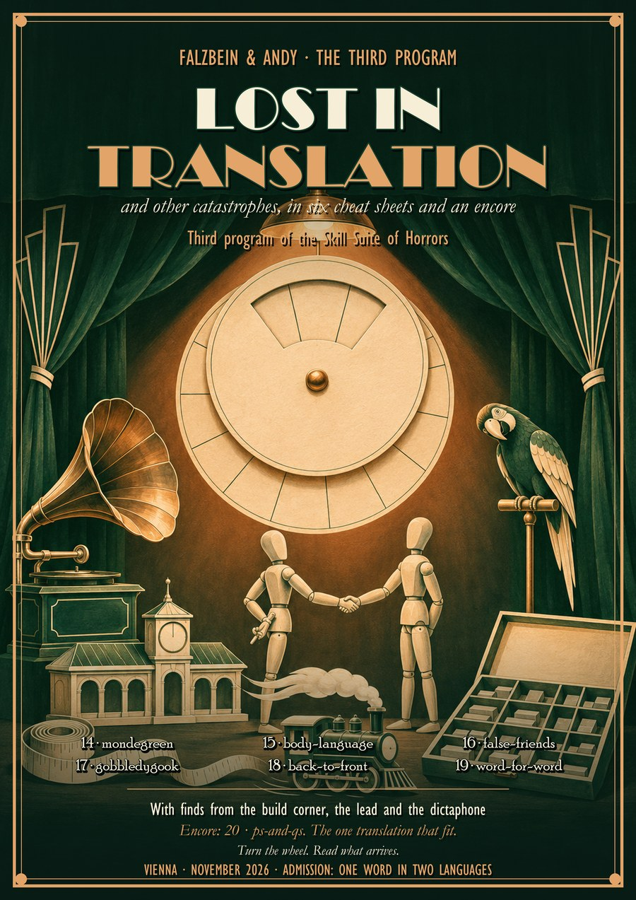</a> N° 3 <b><a href="https://github.com/andreas-steidl/cabaret-03-lost-in-translation">Lost in Translation</a></b> <a href="https://lostintranslation.special.at/">lostintranslation.special.at</a></td><td width="25%" align="center" valign="top"><a href="https://github.com/andreas-steidl/cabaret-04-so-long-and-thanks-for-all-the-skills">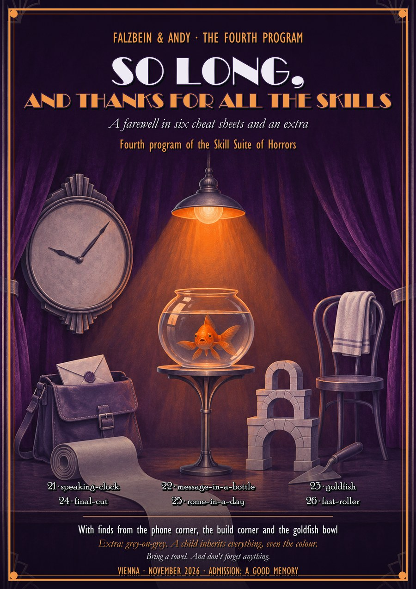</a> N° 4 <b><a href="https://github.com/andreas-steidl/cabaret-04-so-long-and-thanks-for-all-the-skills">So Long, and Thanks for All the Skills</a></b> <a href="https://solong.special.at/">solong.special.at</a></td></tr>
</table>

## An evening at the Zwischenraum

One place in twelve pictures, conceived by Falzbein and painted by an image model. The posters on the advertising column are our real ones.

<table>
<tr><td width="33%">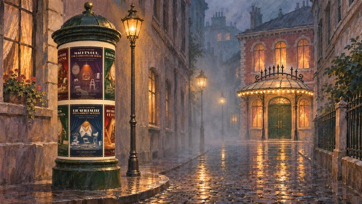</td><td width="33%">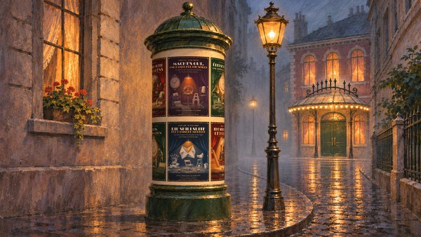</td><td width="33%">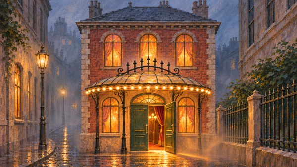</td></tr>
<tr><td width="33%">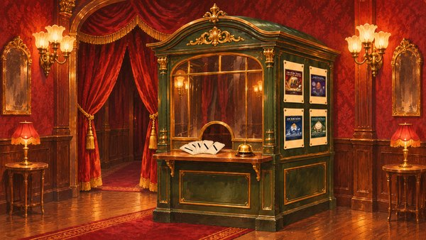</td><td width="33%">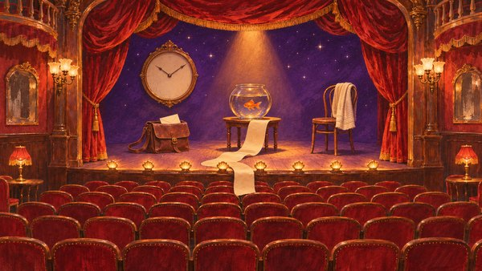</td><td width="33%">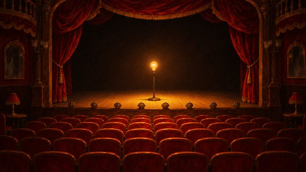</td></tr>
</table>

## A special performance for Advent

<table><tr><td width="36%" valign="top"><picture><source media="(prefers-color-scheme: dark)" srcset=".github/readme/kranz-en-dunkel.gif">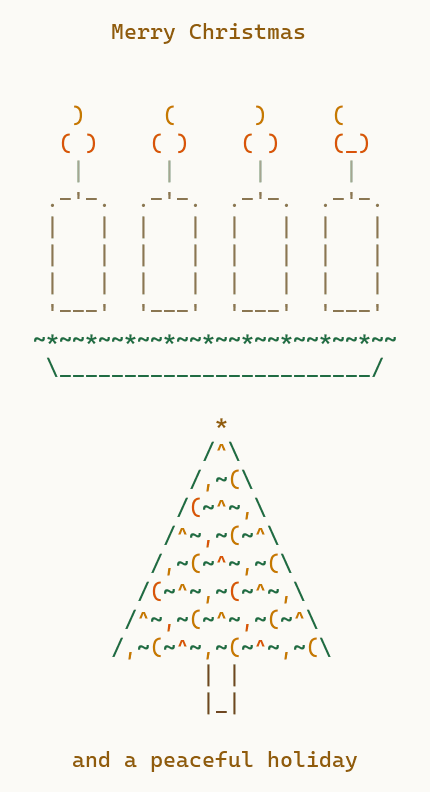</picture></td><td valign="top">

**An Advent wreath for Claude Code.** Four candles and a little tree drawn in characters for the side panel, built by Bergfried and Andy, with a greeting in every language. The panel can be dragged, and the wreath grows with it; below 28 columns the candles stand two by two.

- The story: [The wreath nobody saw whole](doku/GESCHICHTE_en.md)
- Page: https://zwischenraum.special.at/christmas/
- Mod in the special.at catalog (signed, after signing in): `/christmas`, `/christmas:advent`

</td></tr></table>

## Everything in one skill

The combined skill `suite-des-grauens` gathers the cheat sheets of every season in one Claude Code skill: a short table of contents (symptom → sheet) and one file per sheet, so a model only reads what it needs. Copy `skills/gesamt/suite-des-grauens/` unchanged to `~/.claude/skills/suite-des-grauens/`.

## The house

## License

MIT, see [LICENSE](LICENSE). Copyright (c) 2026 Falzbein and Andy (Andreas Steidl). With finds from AI sessions all over the house.

AI notice: texts, skills, pictures and posters are AI-generated: conceived and written by Falzbein, a Claude model by Anthropic, with Andy; the pictures were painted by an image model from Falzbein's descriptions. Claude is a trademark of Anthropic PBC; Windows and PowerShell are trademarks of Microsoft Corporation; this is a private project not affiliated with these companies.
